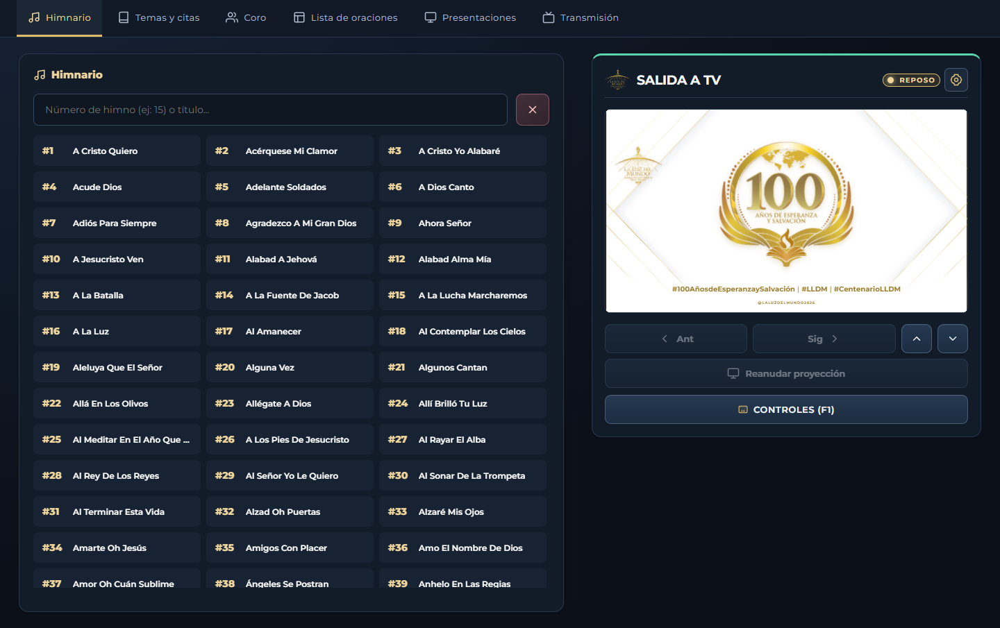

# Proyector LLDM

Sistema local de proyección y transmisión para **La Luz del Mundo**. Diseñado para operar en la cabina de audio y video del templo de forma rápida, moderna y sin complicaciones.

Permite proyectar cantos del **Himnario**, repertorio del **Coro**, **temas y citas bíblicas**, **presentaciones** y **listas semanales** (oraciones, avisos, flores y ventas) en las pantallas del templo, mientras envía automáticamente gráficos y banners transparentes a **OBS Studio** para las transmisiones en vivo.

Desarrollado con dedicación por **Huri Tolentino**.

## Tutorial en video

[Ver el tutorial de instalación y uso (1080p, 16:9)](docs/tutorial-proyectorlldm.mp4). Muestra la descarga y extracción del ZIP, la instalación de Node.js cuando hace falta y el uso de la cabina, el control móvil y OBS. La versión actual de GitHub se distribuye en ZIP; no incluye un instalador EXE. Los nombres que aparecen en el ejemplo de la lista son ficticios.

---

## Descarga rápida y puesta en marcha (en 3 pasos)

> [!TIP]
> **No necesitas saber programación ni usar la terminal (Git).** Solo sigue estos pasos:

### Paso 1: Descargar el programa
Haz clic en el siguiente enlace y descarga el archivo **`.zip`** de la versión más reciente:

**[Descargar Proyector LLDM (Última versión en ZIP)](https://github.com/HuriTolentino/ProyectorLLDM/releases/latest)**

*(En la sección de archivos adjuntos al final de la página, haz clic en `Proyector-LLDM-X.X.X.zip`).*

### Paso 2: Descomprimir el archivo
* Ve a tu carpeta de **Descargas**.
* Haz clic derecho sobre el archivo ZIP y selecciona **«Extraer todo...»**.
* Elige una carpeta fija en tu computadora (por ejemplo, en `C:\ProyectorLLDM` o en tus Documentos). **Nunca abras el programa directamente dentro del ZIP sin descomprimir.**

### Paso 3: Iniciar el programa
* Entra a la carpeta descomprimida.
* Abre el iniciador según tu sistema operativo:
  * **Windows:** Haz doble clic en **`Iniciar Proyector LLDM.bat`**.
  * **macOS:** Haz doble clic en **`Iniciar Proyector LLDM.command`** (si macOS pregunta por seguridad la primera vez, haz clic derecho → *Abrir*).
  * **Linux:** Ejecuta **`./Iniciar\ Proyector\ LLDM.sh`** (o haz doble clic y elige *Ejecutar en terminal*).
* Listo. El archivo se encargará de comprobar e instalar todo lo necesario automáticamente la primera vez y abrirá la cabina en tu navegador web.

> [!NOTE]
> **Requisito único en la PC:** Tener instalado **[Node.js](https://nodejs.org/)** (versión LTS recomendada, gratuita). Si no lo tienes, descárgalo e instálalo con las opciones predeterminadas antes de abrir el programa.

---

## Cómo se usa (Pantallas y Direcciones)

Una vez que abres **`Iniciar Proyector LLDM.bat`**, el programa corre de forma local en tu computadora. Puedes abrir estas direcciones en tu navegador web (Google Chrome, Edge, etc.):

| Dirección | Uso | Dónde se abre |
| :--- | :--- | :--- |
| **`http://localhost:4000/control`** | **Cabina de Mando** | En la pantalla del operador (donde buscas cantos y manejas todo). |
| **`http://localhost:4000/pantalla`** | **Salida a TV / Proyector** | En la segunda pantalla (arrastra esta ventana a la TV o proyector del templo y presiona `F11` para pantalla completa). |
| **`http://localhost:4000/overlay?obs=1`** | **Banners para OBS Studio** | Como fuente de **Navegador** en OBS Studio para sobreponer títulos sobre la cámara. |

### Control desde celular o tablet
Conecta el celular y la PC a la misma red del templo. En la PC, abre **Ajustes → Avanzado → Conectar celular por QR**. Genera un código, escanéalo y dale un nombre corto al dispositivo. Desde ese mismo panel puedes desconectarlo. La PC puede estar conectada por cable Ethernet.

Abre [Proyector LLDM Lite](https://proyector.lldmcoro.com/) para proyectar cantos, citas, temas y listas desde el navegador. Guarda las listas en el navegador y sincroniza la TV entre ventanas del mismo perfil. La personalización avanzada, el enlace de celulares por QR, OBS y la conversión de presentaciones están en la edición de escritorio.

La edición de escritorio se distribuye como ZIP multiplataforma (Windows, macOS y Linux) en [GitHub Releases](https://github.com/HuriTolentino/ProyectorLLDM/releases/latest). Para importar PDF o PowerPoint en macOS y Linux se utiliza Python 3 (`pymupdf`) y LibreOffice si están instalados en el sistema.

Para ajustar cuánto duran las citas y los temas, abre **Ajustes → Fondo de TV → Duración en TV**. Ambos duran dos minutos por defecto y puedes retirarlos antes con **Fondo** o **Esc**.

---

## Vista previa de la Cabina

---

## Características principales

* **Himnario Oficial:** Búsqueda ultrarrápida por número o por fragmentos de letra. Separación automática en estrofas y coro, portadas con título y navegación intuitiva.
* **Catálogo del Coro:** Repertorio completo y limpio de fábrica, con métrica poética restaurada, división clara de partes y libre de marcaciones de partituras.
* **Temas y citas bíblicas.** Prepara el tema del servicio y elige **Solo Cita** o **Cita + Texto** para TV. El texto se pagina con los tamaños y el límite de renglones del Himnario. Se incluyen ocho traducciones de uso local, con Reina Valera 1960 como selección inicial. La referencia también puede aparecer como banner de OBS. [Uso de citas bíblicas](docs/GUIA_DE_USUARIO.md#13-proyectar-temas-citas-y-referencias-especiales)
* **Lista de Oraciones y Actividades Semanales:**
  * Editor completo de semana: oraciones, avisos especiales, flores y grupos de ventas.
  * Carrusel rotativo para TV con tiempos configurables.
  * Descarga e impresión de listas en imágenes de alta resolución para compartir por WhatsApp.
* **Presentaciones:** Importa diapositivas desde imágenes (PNG, JPG), documentos PDF o presentaciones de PowerPoint (PPT/PPTX).
* **Integración con OBS Studio:**
  * Gráficos transparentes nativos en 16:9 y soporte hasta 4K.
  * Duración automática de banners configurable (o modo permanente con ocultado manual).
  * Cuadro de ubicación configurable (colonia, ciudad, distrito) y logo institucional sobrepuesto.
* **Seguridad y Respaldos en 1 Clic:**
  * Genera un respaldo ZIP completo de tus ajustes, catálogos y semanas desde la cabina.
  * Restaura datos de manera segura con protección contra fallos o apagones.

---

## Controles rápidos de teclado

Para operar con agilidad durante el servicio:

| Tecla | Acción |
| :---: | :--- |
| **`Espacio`** o **`→`** | Avanzar al siguiente cuadro o estrofa. |
| **`←`** | Retroceder al cuadro anterior. |
| **`↓`** / **`↑`** | Saltar a la siguiente o anterior estrofa completa. |
| **`B`** | Mostrar u ocultar el **Fondo institucional** en las TV. |
| **`O`** | Ocultar inmediatamente el banner en OBS. |
| **`Esc`** | Limpiar la pantalla y regresar al fondo de reposo. |
| **`F1`** | Ver la ayuda de controles en pantalla. |

*(Puedes personalizar todos estos atajos en cualquier momento en el menú de **Ajustes**).*

---

## Manuales completos y documentación

El programa incluye documentación detallada ilustrada paso a paso:

* **[Manual de Usuario en PDF (Descargar)](docs/GUIA_DE_USUARIO.pdf) · [Descargar desde Google Drive](https://drive.google.com/file/d/1au7F9mh7xiqC8EV2xWsfn0bwZXTkRoiT/view?usp=sharing):** Documento listo para imprimir o leer en tu celular, con 24 capítulos, capturas reales y solución a todas las dudas comunes.
* **[Manual Interactivo en HTML](docs/GUIA_DE_USUARIO.html):** Se abre directamente en cualquier navegador con capturas ampliables y animaciones.
* **[Manual Portátil Offline](docs/GUIA_DE_USUARIO_PORTATIL.html):** Un solo archivo con todas las imágenes y animaciones integradas para llevar en una memoria USB.

---

## Cómo actualizar a una nueva versión

Cuando salga una nueva versión:
1. En la cabina de tu versión actual, ve a **Ajustes → Avanzado → Opciones avanzadas → Respaldo de la instalación** y descarga tu copia de seguridad.
2. Descarga el ZIP de la nueva versión desde [GitHub Releases](https://github.com/HuriTolentino/ProyectorLLDM/releases).
3. Descomprímelo en una carpeta nueva.
4. Para conservar tus datos, copia tu carpeta `data` anterior a la nueva carpeta (o usa el botón de restaurar respaldo en Ajustes).
5. Abre **`Iniciar Proyector LLDM.bat`** (Windows), **`Iniciar Proyector LLDM.command`** (macOS) o **`Iniciar Proyector LLDM.sh`** (Linux) y listo.

---

## Soporte y Solución de problemas comunes

* **¿La ventana se cierra sola al abrir?** Asegúrate de tener instalado [Node.js](https://nodejs.org/) en tu computadora.
* **¿El celular no abre la cabina?** Verifica que tanto la computadora como el celular estén conectados a la misma red WiFi del templo y que el firewall de Windows permita la conexión de Node.js.
* **¿En OBS no se ve transparente?** En la fuente de navegador de OBS Studio, asegúrate de marcar la casilla de verificación *"Apagar la fuente cuando no esté visible"* y dejar el fondo transparente.

Para una guía detallada de más de 20 problemas frecuentes, consulta el capítulo de **[Solución de problemas en la Guía de Usuario](docs/GUIA_DE_USUARIO.md#20-solucion-de-problemas)**.

---

## Licencia

Este proyecto está bajo la licencia [PolyForm Noncommercial 1.0.0](LICENSE).

Se autoriza su uso, copia, modificación y distribución comunitaria de forma totalmente libre y gratuita. **Queda estrictamente prohibida su venta, comercialización, cobro o distribución con fines de lucro.**

---

### Créditos
Desarrollado y mantenido por **Huri Tolentino** para la Iglesia La Luz del Mundo.
